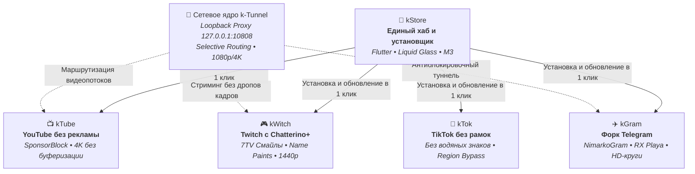

# 🪐 k-Ecosystem (by kipsway)

Премиальная мобильная экосистема для Android: кастомные клиенты без рекламы, со встроенным сетевым ядром **k-Tunnel** для гарантированного обхода замедлений (DPI) и единым дизайн-кодом **«Жидкое стекло + Material You 3 + акценты Chatterino+»**.

---

## 📱 Карта приложений



---

## 🌟 Ключевые принципы экосистемы

### 1. Киллер-фича: Встроенное ядро k-Tunnel
Во все медиа-приложения (**kTube**, **kWitch**, **kGram**) встроено легковесное локальное прокси-ядро (`127.0.0.1:10808` SOCKS5 / `10809` HTTP):
- **Без внешнего VPN:** Пользователю не нужно включать сторонний VPN на смартфоне — видео и стримы ускоряются прямо внутри приложения.
- **Нулевой расход батареи:** Ядро спит в простое и активируется только при запросе тяжелых медиасегментов (`*.googlevideo.com`, Twitch HLS).
- **Индикация в плеере:** Вытянутая кнопка-капсула «Ускорение k-Tunnel» со светодиодом и живым пингом («28 мс»).

### 2. Дизайн-триумвират: «Жидкое стекло + Material You 3 + Мозаика»
- **Палитра Chatterino+ («Мозаика» от Rish, [chat.eblo.id](https://chat.eblo.id/)):**
  - Глубокий ониксовый фон `#0A0A0C` (вместо серого дефолта).
  - Поверхности панелей `#0F0F12`, карточки `#1C1B21`, границы `#2C2B32`.
  - Лавандовый акцент `#B8A7F0`, светлая лаванда `#D9CFFD`, активная подложка `#2A2442`.
- **Жидкое стекло (Liquid Glass):** Размытие заднего фона `BackdropFilter` (`sigma: 24`), оптический линзовый блик 1px по верхнему краю рамки (`rgba(255,255,255,0.18)` → `rgba(255,255,255,0.02)`).
- **Material You 3 Expressive:** Радиусы карточек `24px` / `28px`, кнопки-капсулы `999px` (`StadiumBorder`), жирный шрифт **Montserrat** (`w800`, трекинг `-0.5`).

### 3. Человеческий русский язык (Anti-AI Slop)
Никакого корпоративного робо-языка. Все кнопки простые и понятные: «Установить», «Обновить», «Ускорение k-Tunnel», «Пропуск рекламы», «Фоновое воспроизведение», «by kipsway».

---

## 📁 Структура репозитория

| Папка | Спецификация | Описание проекта |
|---|---|---|
| **[kstore/](file:///C:/Users/ДДД/Desktop/s/kstore)** | `01_KSTORE_SPEC.md` | Хаб-каталог на Flutter с установкой приложений в 1 клик и парящим доком |
| **[ktok/](file:///C:/Users/ДДД/Desktop/s/ktok)** | `02_KTOK_SPEC.md` | Мод TikTok (MargyT/ReVanced): скачивание без водяного знака, Region Spoofing, AdBlock |
| **[kgram/](file:///C:/Users/ДДД/Desktop/s/kgram)** | `03_KGRAM_SPEC.md` | Форк Telegram на базе NimarkoGram (v13.2.2), плеер RX Playa, k-Tunnel, тема «Мозаика» |
| **[ktube/](file:///C:/Users/ДДД/Desktop/s/ktube)** | `04_KTUBE_SPEC.md` | Клиент YouTube с ядром k-Tunnel 4K, капсулой пинга в плеере, SponsorBlock, AMOLED-оникс |
| **[kwitch/](file:///C:/Users/ДДД/Desktop/s/kwitch)** | `05_KWITCH_SPEC.md` | Клиент Twitch со встроенным движком Chatterino+ by Rish (7TV/BTTV/FFZ, Name Paints, 1440p) |
| **[chatterino_plus/](file:///C:/Users/ДДД/Desktop/s/chatterino_plus)** | — | Оригинальные ассеты движка чата Rish (`page.css`, `main.js`) |

---

## ⚡ Быстрый старт сборки

### Единая синхронизация экосистемы (One-Click)
Для синхронизации ключей подписи, валидации компонентов и обновления мастер-манифеста запустите:
```powershell
# Вариант 1 (Двойной клик в проводнике Windows):
.\build_ecosystem.bat

# Вариант 2 (PowerShell):
.\build_ecosystem.ps1
```

Мастер-манифест релиза генерируется в файл **[ECOSYSTEM_MANIFEST.json](file:///C:/Users/ДДД/Desktop/s/ECOSYSTEM_MANIFEST.json)**.

### Сборка отдельных приложений

#### 📺 Сборка kTube:
1. Поместите чистый APK YouTube v19.x в папку `ktube/build/input/`.
2. Запустите `ktube/build/build_ktube.bat`.
3. Релизный APK сохранится в `ktube/build/output/kTube-v1.0.0-kipsway-release.apk`.

#### 🏪 Сборка kStore:
```bash
cd kstore
flutter pub get
flutter build apk --release
```

#### 🎮 Сборка kWitch:
```powershell
cd kwitch
.\build_release.bat
```

#### 🎵 Сборка kTok:
```powershell
cd ktok/scripts
.\build_ktok.ps1
```

---

## 🔑 Единый сертификат подписи (Keystore)
Все приложения подписываются общим сертификатом `kipsway.keystore`:
- **Хранилище:** `ktube/build/kipsway.keystore` (синхронизируется скриптом во все подпроекты)
- **Alias:** `kipsway`
- **Пароль:** `kipsway2026`
- **Алгоритм:** RSA-2048 / SHA384withRSA
- **Срок действия:** 10 000 дней (до 2054 года)
- **Преимущество:** Бесшовные обновления модов через **kStore** без конфликта Android Signature Mismatch.

---

## 🤝 Благодарности
- **Rish ([chat.eblo.id](https://chat.eblo.id/)):** Автор движка Chatterino+ и дизайн-системы «Мозаика».
- **Команда NimarkoGram:** Базовый форк Telegram для Android.
- **Команды ReVanced и MargyT:** Фреймворк патчинга мобильных приложений.

---

*(c) 2026 kipsway. Сделано человеком.*
